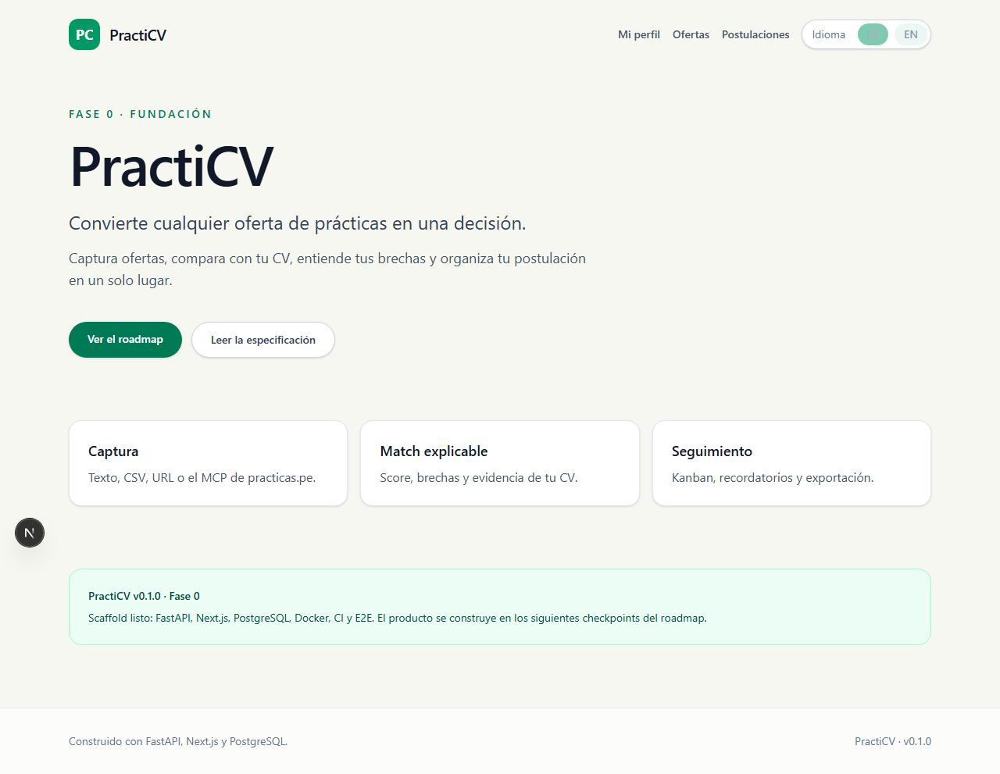
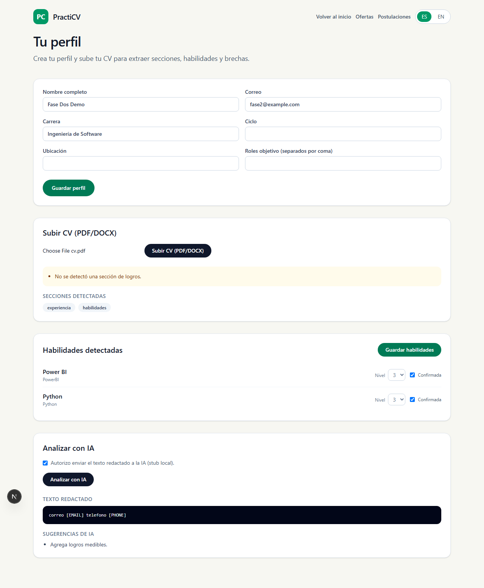
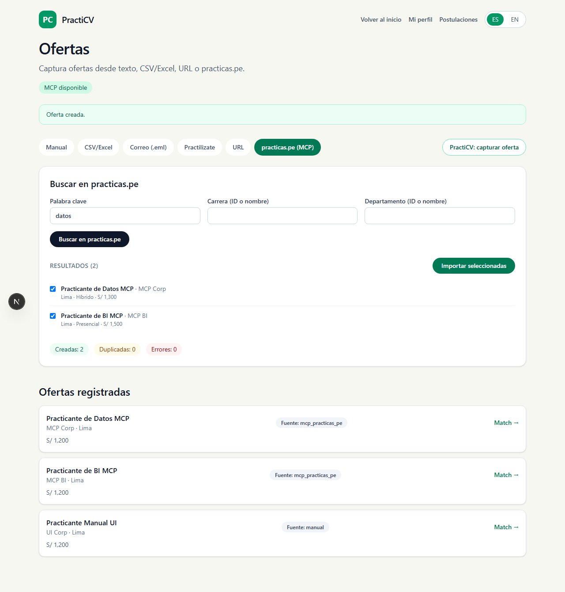
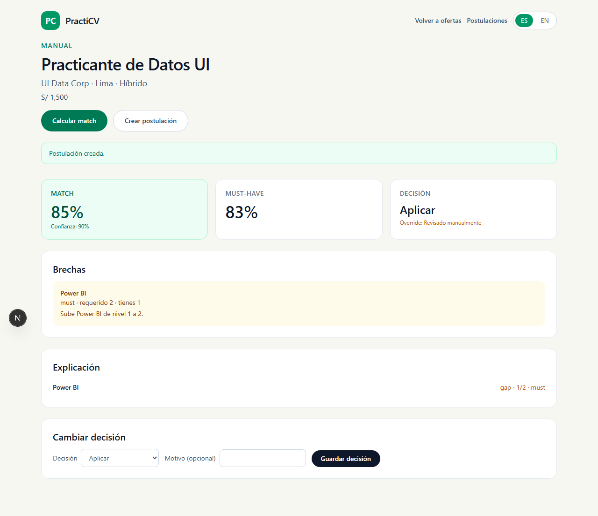
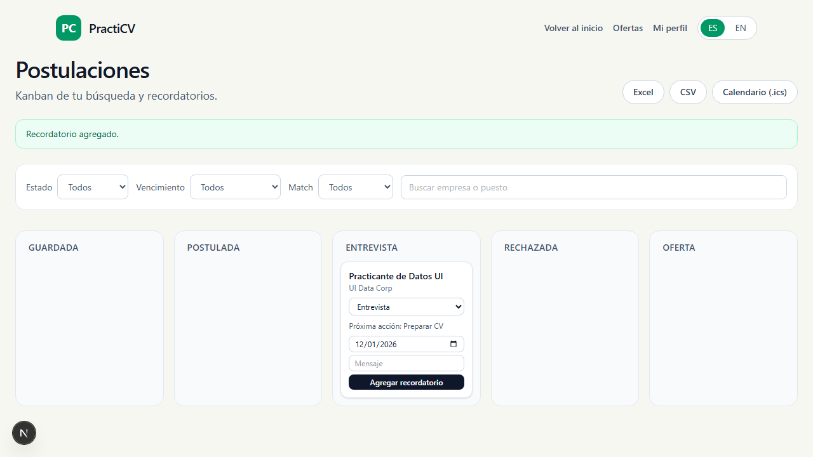

# PractiCV

**An application copilot for students.**

PractiCV turns any internship posting into a decision: it captures the offer, compares it with your CV, explains your gaps, and organizes your application in a Kanban board with reminders.

> **Status:** **v0.1.0 MVP complete**. Profile/CV, multi-source offers, explainable matching, Kanban, reminders, and exports. Real-offer dogfooding remains an optional manual step.
>
> **Español:** [README.md](README.md)

---

## Why PractiCV?

Students apply blindly: they review many postings without criteria, use the same CV for everything, and forget deadlines. Job boards solve publishing, not personal decision-making.

PractiCV answers:

- What does this posting actually require?
- Which requirements do I meet and which do I miss?
- What CV evidence supports each requirement?
- Should I apply now or prepare first?
- Where did I apply, and what is next?

---

## What it does

1. **Profile and CV:** create a profile and upload a PDF or DOCX CV.
2. **Capture:** add offers from text, CSV, URL, or the practicas.pe MCP.
3. **Extraction:** detect requirements, skills, and levels.
4. **Explainable match:** calculate fit and show gaps with evidence.
5. **Kanban:** saved, applied, interview, rejected, offer.
6. **Reminders:** deadlines and next actions, with `.ics` export.
7. **Export:** Excel, CSV, and calendar.

It is not a job board, it does not auto-apply, and it does not promise employment.

---

## Demo

[Watch a short demo video](docs/assets/demo.webm)











---

## Profile and CV

- Profile CRUD with academic data and target roles.
- **PDF or DOCX** CV upload with text and table extraction.
- Section detection: profile, education, experience, projects, skills, certifications, and languages.
- Skill extraction with `skills.yaml` and aliases (`PowerBI` → `Power BI`, `PostgreSQL` → `PostgreSQL`).
- Confirmation screen to correct level (0–3) and mark skills as confirmed.
- The original file is stored locally in `cv_documents.file_bytes`.
- AI analysis **only when sections or skills are missing** and with explicit consent.
- Email and phone are redacted (`[EMAIL]`, `[PHONE]`) before sending text to the AI adapter.

---

## Offers and sources

- **Manual:** validated form.
- **CSV/Excel:** downloadable template, preview, and row-level errors.
- **URL:** `JobPosting` JSON-LD and OpenGraph; only extracted text is stored, never raw HTML.
- **MCP `practicas-pe`:** search, detail, and import; if unavailable, the UI falls back to text/CSV/URL.
- **Normalization:** canonical URL, salary, dates, modality, and location.
- **Deduplication:** `dedupe_hash` by canonical URL or title + company + deadline.
- **Provenance:** `source_type`, `source_url`, and `captured_at` on every offer.
- **Limits:** 5 MB per CV/file, 500 rows per import.

---

## Architecture

PractiCV is a **local-first modular monolith**: microservice-style boundaries and contracts, but a single deployable.

```text
Next.js (ES/EN UI)
        │
        ▼
FastAPI (API + use cases)
        │
   ┌────┼────────────┬──────────────┐
   ▼    ▼            ▼              ▼
Profile Offers     Matching     Applications
CV      Ingestion  Rules        Kanban
        │                           │
        ▼                           ▼
Sources: MCP, text, CSV, URL    Exports: Excel, CSV, ICS
```

**Contexts:**

- `profile`: profile, CV, skills.
- `offers`: capture, normalization, deduplication, provenance.
- `matching`: requirements, score, explanation.
- `applications`: Kanban, events, reminders.
- `exports`: Excel, CSV, ICS.

**Principles:**

- The domain does not depend on FastAPI or SQLAlchemy.
- Contexts communicate through contracts, not tables.
- Ingestion is idempotent.
- If one source fails, the rest keeps working.
- No queues, brokers, or real microservices in the MVP.

---

## Stack

| Layer | Technology |
|---|---|
| Backend | Python 3.13, FastAPI, SQLAlchemy 2, Pydantic v2, Alembic |
| Database | PostgreSQL 17 (local Docker) |
| Frontend | Next.js, TypeScript, Tailwind CSS, dnd-kit |
| Parsing | pdfplumber/pypdf, python-docx, BeautifulSoup, extruct |
| Matching | Deterministic Python rules |
| Export | openpyxl, pandas, ics |
| Testing | pytest + Playwright, E2E-first |
| Infra | Docker Compose, GitHub Actions |

---

## Quick start

```powershell
git clone <repository-url>
cd practicv

# Local PostgreSQL
docker compose up -d db

# Backend
cd backend
python -m venv .venv
.venv\Scripts\Activate.ps1
pip install -e ".[dev]"
alembic upgrade head
python -m practicv seed --demo --volume 1000
uvicorn practicv.main:app --reload

# Frontend
cd ..\frontend
npm install
npm run dev
```

Open `http://localhost:3000`. PostgreSQL listens on `localhost:5434`.

### Docker Compose

```powershell
docker compose up --build
```

- Frontend: `http://localhost:3001`
- Backend: `http://localhost:8001`
- Health: `http://localhost:8001/health`

Docker ports are 3001/8001 to avoid conflicts with other local projects.

### Demo mode

```powershell
python -m practicv seed --demo
```

Loads a synthetic profile, sample offers, and matches. No personal data is used.

---

## How to use it

### 1. Create a profile

Fill in degree, cycle, location, target roles, and salary expectation.

### 2. Upload a CV

Upload a PDF or DOCX. PractiCV extracts text and skills with local rules. Review, correct, and confirm.

If a section cannot be parsed, you can enable “analyze with AI”. Email and phone are redacted before sending.

### 3. Add offers

- **practicas.pe MCP:** search by degree, department, and modality.
- **Text:** paste the description from any portal.
- **CSV/Excel:** import multiple offers.
- **URL:** capture JSON-LD/OpenGraph when available.

### 4. Review the match

You see:

- overall score,
- must-have score,
- concrete gaps,
- CV evidence,
- recommendation.

### 5. Organize the application

Move the offer to Saved, Applied, Interview, Rejected, or Offer. Add notes and the next action.

### 6. Reminders and export

Export `.ics` to your calendar and Excel/CSV for your records. Email delivery
uses the manual `PractiCV Recordatorios` flow; see
[`docs/power-automate.md`](docs/power-automate.md).

---

## Data sources

| Source | Use | Required? |
|---|---|---|
| `practicas-pe` MCP | Search practicas.pe offers | No |
| Pasted text | Any portal | No |
| CSV/Excel | Bulk import | No |
| URL + JSON-LD | Single capture | No |
| Practilizate | Historical benchmarks | No |

**PractiCV does not depend on Practilizate or the MCP.** If they are unavailable, the app works with text, CSV, and URL.

---

## Explainable matching

For each requirement:

- `w`: weight (must-have = 3, nice-to-have = 1, unknown = 1.5).
- `r`: required level (1–3).
- `u`: user level (0–3).
- `coverage = min(u, r) / r`.

```text
overall_score = 100 * Σ(w * coverage) / Σ(w)
must_have_score = 100 * Σ(w * coverage must) / Σ(w must)
```

Decision:

- `must_have_score >= 85` and `overall >= 80`: **Apply**.
- `must_have_score >= 60`: **Apply with gaps**.
- Otherwise: **Prepare CV**.

The user can correct skills, levels, and the decision. The score is an **estimated fit**, not a hiring probability.

---

## Data model and SQL

PractiCV uses **PostgreSQL 17** with SQLAlchemy 2, Alembic, and `psycopg` 3.

- Normalized relational model: profiles, CVs, skills, offers, matches, applications, events, and reminders.
- `offers.dedupe_hash` UNIQUE for idempotent ingestion.
- `applications(profile_id, offer_id)` UNIQUE to avoid duplicate applications.
- `JSONB` for profiles, explanations, and flexible configuration.
- `v_offer_ranking` view with CTE + `ROW_NUMBER()`.
- PL/pgSQL function `fn_top_offers_for_profile(uuid)`.
- Covering index `ix_matches_profile_score_covering`.
- `EXPLAIN ANALYZE` documented in [`docs/sql-performance.md`](docs/sql-performance.md).

**Why PostgreSQL and not SQLite:** PostgreSQL demonstrates real advanced SQL (CTEs, window functions, JSONB, views, PL/pgSQL, indexes, and execution plans). SQLite is useful for prototypes, but it falls short for that level and for data/BI roles.

---

## Applications and reminders

- Five-state Kanban: saved, applied, interview, rejected, and offer.
- Move cards by drag-and-drop or with a keyboard-accessible selector.
- Notes, next action, and event history.
- Date reminders and `.ics` calendar export.
- Filters by status, deadline, and match presence/score.

## Exports

- **Excel:** `Postulaciones`, `Ofertas`, `Matches`, `Brechas`, `Timeline`, and `Habilidades`.
- **CSV:** application funnel.
- **ICS:** deadlines, next actions, and reminders.
- Downloads from `/postulaciones` with `profile_id`.

## Privacy

- Local-first: your CV and applications live on your machine.
- No telemetry by default.
- No PII in the repository.
- No secrets in Git.
- No mass scraping.
- No auto-apply.
- LLM is optional and consent-based.
- You can export and delete your data.

---

## Testing

- E2E-first.
- E2E as the main mechanism.
- No unit tests after writing code.
- Medium-hard scenario.
- Repeatable artifacts in `artifacts/e2e/`.

```powershell
pytest tests/e2e
```

Artifacts:

```text
artifacts/e2e/
├─ run_manifest.json
├─ matches.json
├─ applications.xlsx
├─ applications.csv
├─ calendar.ics
├─ quality_report.json
└─ checksums.sha256
```

`quality_report.json` records the flow checks (offer creation, gap-free match, application, reminder, Excel sheets, CSV header, and ICS), per-step timing metrics, and hashes of the payload artifacts.

---

## Metrics

> Real E2E and synthetic-seed metrics. Real-offer dogfooding remains a manual pending step.

| Metric | Value |
|---|---|
| Offers in synthetic seed | 1,005 |
| Matches in synthetic seed | 505 |
| Backend E2E tests | 18 passed |
| UI E2E tests (Playwright) | 5 passed |
| Backend E2E runtime | ~10 s |
| Artifact checksums | 5/5 OK |
| Critical flows covered | Profile/CV, offers, match, applications, exports |
| Real-offer dogfooding | Pending (manual, optional) |

---

## Limitations

- v0.1 is local-first and single-user.
- CV parsing may fail on complex formats; the user corrects it.
- URL capture is best effort; some portals block it.
- The MCP may be unavailable; manual fallback exists.
- The match is a guide, not a guarantee.
- No auto-apply.
- No mobile app.
- No multi-user support.

---

## Roadmap

- **v0.1 (MVP complete):** profile, CV, multi-source capture, match, Kanban, reminders, and export.
- **v0.2 (in progress):** documented manual Power Automate flow; bookmarklet, email alerts, Practilizate adapter, and Power BI pending.
- **v0.3:** multiple CV versions and a public demo deploy.

See [`docs/v0.2-plan.md`](docs/v0.2-plan.md) and [ROADMAP.md](ROADMAP.md).

---

## License

MIT for the code. Third-party data keeps its own terms.

---

## Credits

- Offer source: [practicas.pe](https://www.practicas.pe/). PractiCV is not affiliated.
- Product inspiration: Practilizate, the Peruvian internship observatory.
- Built as a portfolio project for data/BI and software roles.
