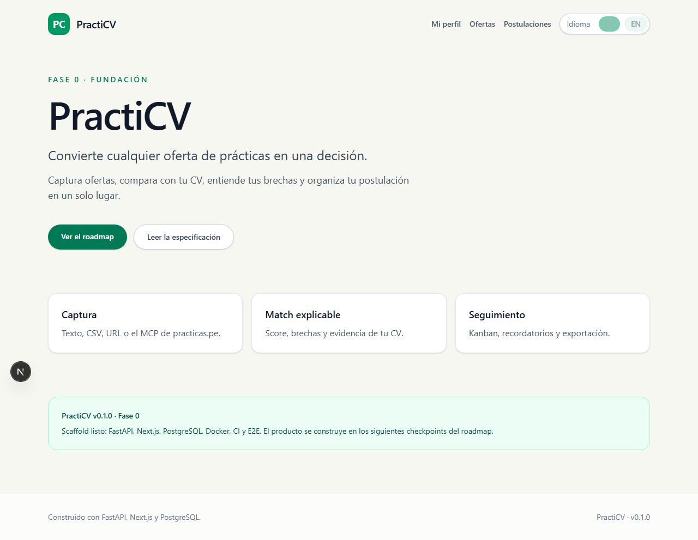
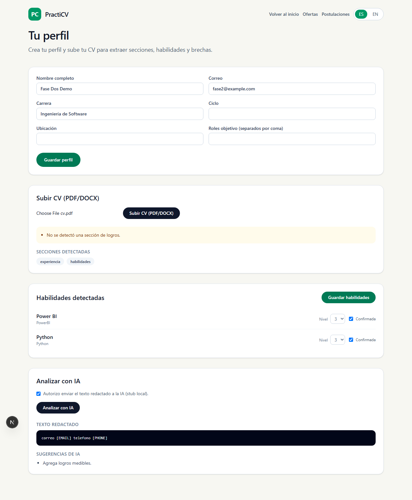
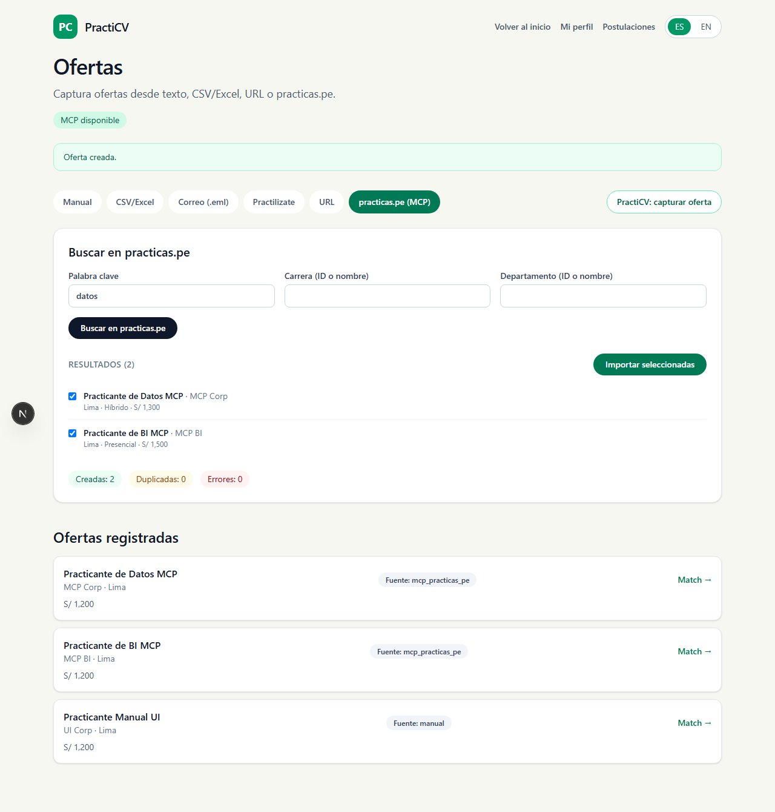
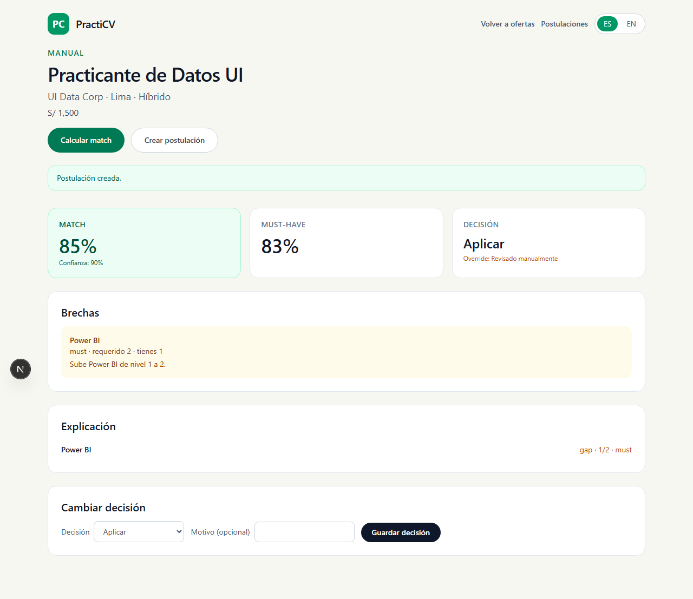
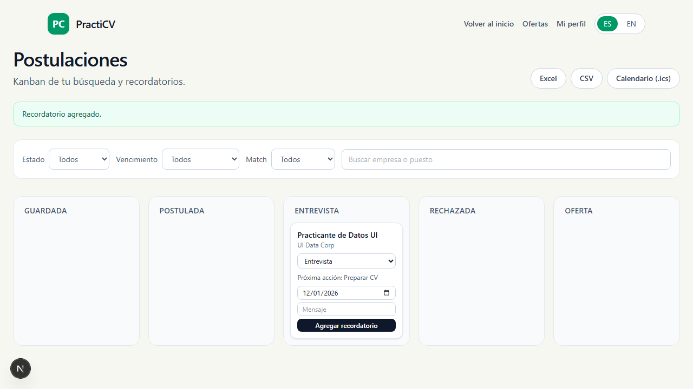
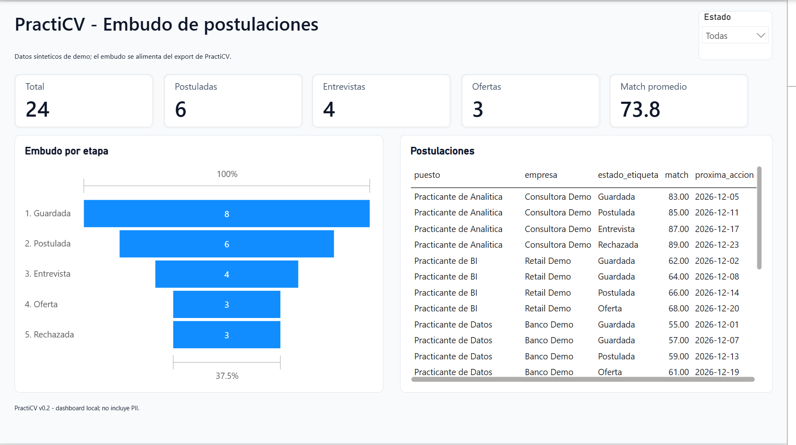

# PractiCV

**Copiloto de postulaciones para estudiantes.**

PractiCV convierte cualquier oferta de prácticas en una decisión: captura la oferta, la compara con tu CV, te explica qué te falta y organiza tu postulación en un Kanban con recordatorios.

> **Estado:** **v0.2.1 - Gmail OAuth en vivo**. Perfil/CV, ofertas multi-fuente, bookmarklet, Gmail conectado, importación `.eml`, Practilizate opcional, matching explicable, Kanban, recordatorios, exportaciones y dashboard Power BI. Outlook/Microsoft Graph queda como extensión futura. El dogfooding con ofertas reales sigue como paso manual opcional.
>
> **English:** [README.en.md](README.en.md)

---

## ¿Por qué PractiCV?

Los estudiantes postulan a ciegas: revisan muchas ofertas sin criterio, usan el mismo CV para todo y olvidan fechas límite. Las bolsas de trabajo resuelven la publicación, no la decisión personal.

PractiCV responde:

- ¿Qué requisitos pide realmente esta oferta?
- ¿Cuáles cumplo y cuáles no?
- ¿Qué evidencia de mi CV respalda cada requisito?
- ¿Vale la pena postular o me conviene prepararme primero?
- ¿A qué postulé y qué sigue?

---

## Qué hace

1. **Perfil y CV:** crea tu perfil y sube tu CV en PDF o DOCX.
2. **Captura:** agrega ofertas desde texto, CSV, URL, el MCP de practicas.pe, el bookmarklet, Gmail conectado o un correo `.eml`.
3. **Extracción:** detecta requisitos, habilidades y niveles.
4. **Match explicable:** calcula coincidencia y muestra brechas con evidencia.
5. **Kanban:** guarda, postula, agenda entrevista, registra rechazo u oferta.
6. **Recordatorios:** fechas límite y próximas acciones, con exportación `.ics`.
7. **Exportación:** Excel, CSV y calendario.
8. **Dashboard Power BI:** embudo de postulaciones, match promedio y detalle por estado.

No es un job board, no postula automáticamente y no promete empleo.

---

## Demo

[Ver demo corta en video](docs/assets/demo.webm)













---

## Perfil y CV

- CRUD de perfil con datos académicos y roles objetivo.
- Subida de CV en **PDF o DOCX**, con extracción de texto y tablas.
- Detección de secciones: perfil, educación, experiencia, proyectos, habilidades, certificaciones e idiomas.
- Extracción de habilidades con `skills.yaml` y alias (`PowerBI` → `Power BI`, `PostgreSQL` → `PostgreSQL`).
- Pantalla de confirmación para corregir nivel (0–3) y marcar habilidades como confirmadas.
- El archivo original se guarda localmente en `cv_documents.file_bytes`.
- Análisis con IA **solo si faltan secciones o habilidades** y con consentimiento explícito.
- Antes de enviar texto a la IA se redactan correo y teléfono (`[EMAIL]`, `[PHONE]`).

---

## Ofertas y fuentes

- **Manual:** formulario con validación.
- **CSV/Excel:** plantilla descargable, previsualización y errores por fila.
- **URL:** JSON-LD `JobPosting` y OpenGraph; solo se guarda texto extraído, nunca HTML crudo.
- **Bookmarklet:** captura la página visible, previsualiza y confirma antes de guardar.
- **Gmail OAuth:** conecta tu cuenta con `gmail.readonly`, busca alertas y previsualiza enlaces; token en el llavero.
- **Correo `.eml`:** importa enlaces de una alerta de Gmail/Outlook; el usuario elige cuáles.
- **Practilizate:** adaptador opcional para importar su CSV; desactivado por defecto.
- **MCP `practicas-pe`:** búsqueda, detalle e importación; si no está disponible, la UI ofrece texto/CSV/URL.
- **Normalización:** URL canónica, sueldo, fechas, modalidad y ubicación.
- **Deduplicación:** `dedupe_hash` por URL canónica o título + empresa + fecha.
- **Procedencia:** `source_type`, `source_url` y `captured_at` en cada oferta.
- **Límites:** 5 MB por CV/archivo, 2 MB por `.eml`, 500 filas por importación, 30 enlaces por correo.

---

## Arquitectura

PractiCV es un **monolito modular local-first**: boundaries y contratos de microservicios, pero un solo deployable.

```text
Next.js (UI ES/EN)
        │
        ▼
FastAPI (API + casos de uso)
        │
   ┌────┼────────────┬──────────────┐
   ▼    ▼            ▼              ▼
Profile Offers     Matching     Applications
CV      Ingestion  Reglas       Kanban
        │                           │
        ▼                           ▼
Sources: MCP, texto, CSV, URL   Exports: Excel, CSV, ICS
```

**Contextos:**

- `profile`: perfil, CV, habilidades.
- `offers`: captura, normalización, deduplicación, procedencia.
- `matching`: requisitos, score y explicación.
- `applications`: Kanban, eventos y recordatorios.
- `exports`: Excel, CSV, ICS.

**Principios:**

- El dominio no depende de FastAPI ni SQLAlchemy.
- Los contextos se comunican por contratos, no por tablas.
- La ingesta es idempotente.
- Si una fuente falla, el resto sigue funcionando.
- Sin colas, brokers ni microservicios reales en el MVP.

---

## Stack

| Capa | Tecnología |
|---|---|
| Backend | Python 3.13, FastAPI, SQLAlchemy 2, Pydantic v2, Alembic |
| Base de datos | PostgreSQL 17 (Docker local) |
| Frontend | Next.js, TypeScript, Tailwind CSS, dnd-kit |
| Parseo | pdfplumber/pypdf, python-docx, BeautifulSoup, extruct |
| Matching | Reglas deterministas en Python |
| Exportación | openpyxl, pandas, ics |
| Testing | pytest + Playwright, E2E-first |
| Infra | Docker Compose, GitHub Actions |

---

## Inicio rápido

```powershell
git clone <repository-url>
cd practicv

# PostgreSQL local
docker compose up -d db

# Backend
cd backend
python -m venv .venv
.venv\Scripts\Activate.ps1
pip install -e ".[dev]"
alembic upgrade head
python -m practicv seed --demo --volume 1000
uvicorn practicv.main:app --reload

# Frontend
cd ..\frontend
npm install
npm run dev
```

Abrir `http://localhost:3000`. PostgreSQL escucha en `localhost:5434`.

### Docker Compose

```powershell
docker compose up --build
```

- Frontend: `http://localhost:3001`
- Backend: `http://localhost:8001`
- Health: `http://localhost:8001/health`

Los puertos de Docker se mueven a 3001/8001 para no chocar con otros proyectos locales.

### Modo demo

```powershell
python -m practicv seed --demo
```

Carga un perfil sintético, ofertas de ejemplo y matches. No usa datos personales.

---

## Cómo se usa

### 1. Crear perfil

Completa carrera, ciclo, ubicación, roles objetivo y expectativa de sueldo.

### 2. Subir CV

Sube un PDF o DOCX. PractiCV extrae texto y habilidades con reglas locales. Revisa, corrige y confirma.

Si una sección no se pudo leer, puedes activar “analizar con IA”. Antes de enviar, se redactan correo y teléfono.

### 3. Agregar ofertas

- **MCP practicas.pe:** busca por carrera, departamento y modalidad.
- **Texto:** pega la descripción desde cualquier portal.
- **CSV/Excel:** importa varias ofertas.
- **URL:** captura JSON-LD/OpenGraph cuando esté disponible.

### 4. Revisar el match

Ves:

- score general,
- score de requisitos must-have,
- brechas concretas,
- evidencia del CV,
- recomendación.

### 5. Organizar la postulación

Mueve la oferta a Guardada, Postulada, Entrevista, Rechazada u Oferta. Agrega notas y próxima acción.

### 6. Recordatorios y exportación

Exporta `.ics` para tu calendario y Excel/CSV para tu registro. El envío por
correo se hace con el flujo manual `PractiCV Recordatorios`; ver
[`docs/power-automate.md`](docs/power-automate.md).

---

## Fuentes de datos

| Fuente | Uso | ¿Obligatoria? |
|---|---|---|
| MCP `practicas-pe` | Buscar ofertas de practicas.pe | No |
| Texto pegado | Cualquier portal | No |
| CSV/Excel | Carga masiva | No |
| URL + JSON-LD | Captura individual | No |
| Practilizate | Benchmarks históricos | No |

**PractiCV no depende de Practilizate ni del MCP.** Si no están disponibles, la app funciona con texto, CSV y URL.

---

## Matching explicable

Para cada requisito:

- `w`: peso (must-have = 3, nice-to-have = 1, unknown = 1.5).
- `r`: nivel requerido (1–3).
- `u`: nivel del usuario (0–3).
- `coverage = min(u, r) / r`.

```text
overall_score = 100 * Σ(w * coverage) / Σ(w)
must_have_score = 100 * Σ(w * coverage must) / Σ(w must)
```

Decisión:

- `must_have_score >= 85` y `overall >= 80`: **Aplicar**.
- `must_have_score >= 60`: **Aplicar con brechas**.
- Si no: **Preparar CV**.

El usuario puede corregir habilidades, niveles y decisión. El score es una **coincidencia estimada**, no una probabilidad de contratación.

---

## Modelo de datos y SQL

PractiCV usa **PostgreSQL 17** con SQLAlchemy 2, Alembic y `psycopg` 3.

- Modelo relacional normalizado: perfiles, CVs, skills, ofertas, matches, postulaciones, eventos y recordatorios.
- `offers.dedupe_hash` UNIQUE para ingesta idempotente.
- `applications(profile_id, offer_id)` UNIQUE para no duplicar postulaciones.
- `JSONB` para perfiles, explicaciones y configuración flexible.
- Vista `v_offer_ranking` con CTE + `ROW_NUMBER()`.
- Función PL/pgSQL `fn_top_offers_for_profile(uuid)`.
- Índice covering `ix_matches_profile_score_covering`.
- `EXPLAIN ANALYZE` documentado en [`docs/sql-performance.md`](docs/sql-performance.md).

**Por qué PostgreSQL y no SQLite:** PostgreSQL permite demostrar SQL avanzado de verdad (CTEs, window functions, JSONB, vistas, PL/pgSQL, índices y planes de ejecución). SQLite es útil para prototipos, pero se queda corto para ese nivel y para los roles de datos/BI.

---

## Postulaciones y recordatorios

- Kanban con cinco estados: guardada, postulada, entrevista, rechazada y oferta.
- Movimiento por arrastrar y soltar o por selector accesible con teclado.
- Notas, próxima acción e historial de eventos.
- Recordatorios por fecha y exportación a calendario `.ics`.
- Filtros por estado, vencimiento y presencia/score de match.

## Exportaciones

- **Excel:** `Postulaciones`, `Ofertas`, `Matches`, `Brechas`, `Timeline` y `Habilidades`.
- **CSV:** embudo de postulaciones.
- **ICS:** fechas límite, próximas acciones y recordatorios.
- Descargas desde `/postulaciones` con `profile_id`.

## Privacidad

- Local-first: tu CV y tus postulaciones viven en tu máquina.
- Sin telemetría por defecto.
- Sin PII en el repositorio.
- Sin secretos en Git.
- Sin scraping masivo.
- Sin auto-postulación.
- LLM opcional y con consentimiento.
- Puedes exportar y borrar tus datos.

---

## Testing

- E2E-first.
- E2E como mecanismo principal.
- Sin unit tests después del código.
- Escenario medio-difícil.
- Artefactos repetibles en `artifacts/e2e/`.

```powershell
pytest tests/e2e
```

Artefactos:

```text
artifacts/e2e/
├─ run_manifest.json
├─ matches.json
├─ applications.xlsx
├─ applications.csv
├─ calendar.ics
├─ quality_report.json
└─ checksums.sha256
```

`quality_report.json` registra los checks del flujo (creación de oferta, match sin brechas, postulación, recordatorio, hojas del Excel, cabecera CSV e ICS), métricas de tiempo por paso y hashes de los artefactos de payload.

---

## Métricas

> Métricas reales del E2E y del seed sintético. El dogfooding con ofertas reales queda pendiente como paso manual.

| Métrica | Valor |
|---|---|
| Ofertas en seed sintético | 1,005 |
| Matches en seed sintético | 505 |
| Tests E2E backend | 29 passed |
| Tests E2E UI (Playwright) | 10 passed |
| Gmail OAuth | Conectado; 3 correos listados y 6 ofertas canónicas en un digest |
| Dashboard Power BI | PBIP 0 errores / 0 warnings |
| Tiempo E2E backend | ~10 s |
| Checksums de artefactos | 5/5 OK |
| Flujos críticos cubiertos | Perfil/CV, ofertas, bookmarklet, correo, Practilizate, match, postulaciones, exportaciones, dashboard |
| Dogfooding con ofertas reales | Pendiente (manual, opcional) |

---

## Limitaciones

- v0.2 es local-first y de un solo usuario.
- El parseo de CV puede fallar en formatos complejos; el usuario corrige.
- La captura por URL es best effort; algunos portales bloquean.
- El bookmarklet necesita la app local abierta en el mismo origen.
- Gmail OAuth funciona con Google Personal mode; Outlook/Microsoft Graph no está implementado.
- El token de Gmail vive en el llavero del sistema, no en el repo.
- El adaptador Practilizate está desactivado por defecto y se alimenta por CSV.
- El dashboard Power BI usa datos sintéticos y refresh manual.
- El MCP puede no estar disponible; hay fallback manual.
- El match es una guía, no una garantía.
- No incluye auto-postulación.
- No incluye app móvil.
- No incluye multiusuario.

---

## Roadmap

- **v0.1 (MVP completo):** perfil, CV, captura multi-fuente, match, Kanban, recordatorios y export.
- **v0.2 (features completas):** bookmarklet, Gmail OAuth en vivo, alertas `.eml`, Practilizate opcional, Power Automate manual y dashboard Power BI. Outlook/Microsoft Graph queda como extensión futura.
- **v0.3:** múltiples versiones de CV y deploy público de la demo.

Ver [`docs/v0.2-plan.md`](docs/v0.2-plan.md) y [ROADMAP.md](ROADMAP.md).

---

## Licencia

MIT para el código. Los datos de terceros mantienen sus propios términos.

---

## Créditos

- Fuente de ofertas: [practicas.pe](https://www.practicas.pe/). PractiCV no está afiliado.
- Inspiración de producto: Practilizate, el observatorio de prácticas del Perú.
- Construido como proyecto de portafolio para roles de data/BI y software.
